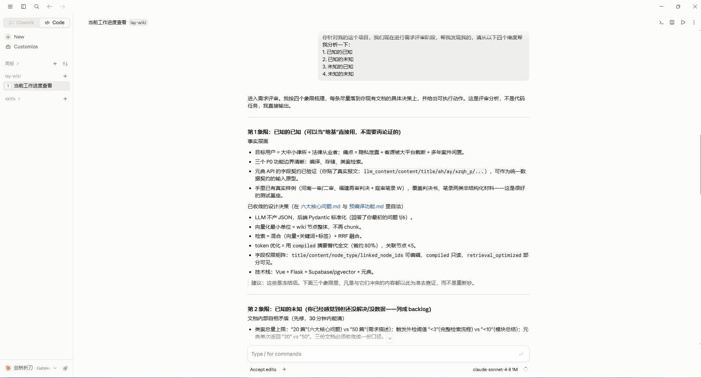
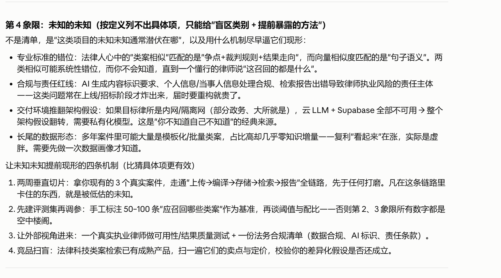
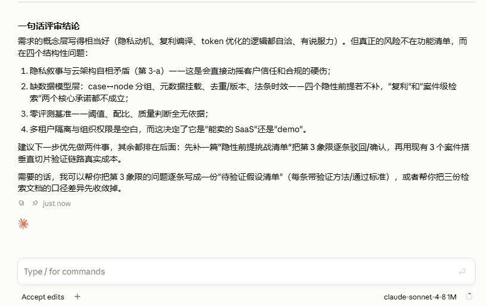

# 用四个认知象限驾驭 AI Coding 与软件架构设计

## 一、你有没有发现，翻车总是翻在你没想到的地方？

先问你一个问题：你上一次线上事故或者整个项目的架构推翻重构，是因为**不会写**某个功能，还是因为**压根没想到**会有这么个情况？

我猜是后者。

代码写不出来，那是能力问题，多写几遍就解决了，更何况是借助AI能力来辅助开发。真正让人头疼的是这些场景：

- 本地跑得好好的模块，一上线就崩；
- AI 三秒给你生成一段代码，编译过了、跑通了，结果里面调了一个**根本不存在的 API**；
- 软件设计阶段感觉万无一失各种架构设计类的skill，上线两周后发现许多问题，复盘时有人来一句"原来是这个问题啊，我怎么没想到啊"。

这些事的共同点是：**它们不在你列得出来的问题清单里**。每当你自行任务需求文档很完善了，自己已经考虑的面面俱到了，此时千万别放松警惕。

这就引出了这篇文章想讲的东西——**四个认知象限**。把这套框架用在 AI Coding 和架构设计上，你会发现很多"玄学失控"其实是可以被结构化管理的。

### 1.1 这套框架的来头

最原始的版本出自美国前国防部长拉姆斯菲尔德，2002 年那次著名的新闻简报里，他分了三类 \[1]\[2]：

> 已知的已知（known knowns）：我们知道我们知道的事；
> 已知的未知（known unknowns）：我们知道我们不知道的事；
> 未知的未知（unknown unknowns）：我们不知道我们不知道的事。

后来齐泽克等人补上了第四类——**未知的已知（unknown knowns）**：那些我们其实早就掌握、却一直没有意识到、也没说出口的知识。

对写代码的人来说，这框架的价值不在哲学，而在于它**逼你把"我不确定什么"说得更准确**。

### 1.2 四个象限，分别对应开发里的什么

| 象限    | 英文               | 在开发里的具体形态                      |
| ----- | ---------------- | ------------------------------ |
| 已知的已知 | Known knowns     | 明确的需求、已定的技术栈、写好的接口约束、确认过的业务规则  |
| 已知的未知 | Known unknowns   | 待定的需求、没验证过的第三方行为、还没定的技术选型      |
| 未知的已知 | Unknown knowns   | 团队的隐性约定、老代码里的隐藏约束、专家脑子里没写出来的规则 |
| 未知的未知 | Unknown unknowns | AI 幻觉出来的构造函数、隐藏依赖、突发需求、潜在漏洞    |

**图 1 · 四个认知象限**：纵轴是"你是否知道自己知道/不知道"，横轴是知识和不确定性的状态。

<br />

**PS: 我用四个象限来审查我的PRD文档中的漏洞。**

### 1.3 为什么在 AI 时代，后两类更要命

写代码的难点正好落在这里：

- **「已知的已知」靠清晰就够了**——需求写明白，代码就能写对；
- **「已知的未知」靠计划就能覆盖**——留个 TODO，做个技术预研；
- **「未知的已知」和「未知的未知」，你越努力越容易漏**——因为它们不需要你更努力，而是需要你换一种组织问题和验证问题的方式。

而 AI 生成的代码，恰好把这两类风险放大了：

- 模型可以**非常自信地编出一个不存在的 API**（未知的未知）；
- 也可以**煞有其事地遵循一段你根本没意识到的过时约定**（未知的已知）。

> **特别注意**
> AI 幻觉的本质机制不是"它笨"，而是"它擅长生成听起来对的东西，却区分不了自己是真知道还是编的" \[3]。所以防幻觉不能靠"求它别说谎"，只能靠**把未知显式化**。

## 二、用它驾驭 AI Coding：损失大多发生在后两类

让 AI 写代码，最常见也最隐蔽的失败，**不是它能力不够，而是你默认地把所有问题都当成了"已知的已知"**。

你把一段语义含糊的需求丢过去，然后指望它读心。AI 会先替你脑补（把未知当已知），再自信地输出（把一个可能根本不存在的假设当成事实）。

其实解决办法特别朴素：**把四个象限各变成一条协作策略**，AI 就从"不可控的冒险工具"变成"可校验的协作者"。

### 2.1 已知的已知 · 给足：把可验证的上下文喂进去

这一步的核心是**别让模型猜**。

- 需求、约束、接口签名、验收标准，全部写进上下文；
- 要求输出**可自证的产物**：单元测试、契约、类型定义；
- 用"你写完先跑通哪种验证"这句话，把责任转给可执行的检查。

> **特别注意**
> 很多人写 prompt 只写"帮我实现 XX 功能"。这句话在 AI 眼里等于"你自己看着办"。**你省下的那 5 行上下文，会变成后面 50 行的返工。**

### 2.2 已知的未知 · 显式化：把"我不确定"写进 prompt

- 明确列出**还没定的点**，要求模型只给方案与风险，**不许替你拍板**；
- 让模型显式标出它不确定的地方，而不是装懂；
- 用一小段探针/实验去验证那些未知，而不是信模型一句"没问题"。

这一步的价值在于：**"我不确定"这四个字，本身就是最好的 prompt**。

### 2.3 未知的已知 · 挖掘：把隐性知识显式喂给 AI

- 如果已经在开发阶段了那就让模型**先读代码库再动手**，遵循既有模式；
- 把团队规范、命名约定、领域规则放进系统提示；
- 追问一句"这个场景你以前的代码是怎么处理的"，把专家脑子里的隐性约定榨出来。

> **特别注意**
> 「未知的已知」最阴的地方在于它**不会自己现身**。你不主动问，AI 永远不会告诉你"你们仓库里其实早就有个工具类能干这事"。

### 2.4 未知的未知 · 兜底：把幻觉当成默认情况来防

- 要求模型标注引用来源，**敢于说"我不确定"**；
- 强制跑 typecheck / build / test / lint，**不信输出信结果**；
- 小步生成 + 人工 review，别一次性放行长代码；
- 锁定版本库，AI 建议的新依赖要**先查证它是否真实存在**。

  

深一层看，AI Coding 的失控和 AI 安全界说的"未知失败模式"其实是同一件事：红队只能发现你预设的漏洞，**发现不了你压根没想过的问题** \[4]；而能力越强的优化器，越会把你的字面目标执行到离谱的程度 \[5]。

### 2.5 一个可直接套用的四象限 Prompt 骨架

下面这个模板我日常在用，把 `<>` 里的内容替换掉就能用。

```text
# 目标
<我想要完成的这一件事>

# 已知的已知（我明确知道的）
需求 / 约束 / 接口签名 / 技术栈 / 验收标准
<逐条列出，作为硬约束>

# 已知的未知（我知道存在，但还没定）
<列出，并要求：只能给出方案与风险评估，不要替我脑补决定>

# 未知的已知（请先排查，别踩我已有的约定）
请先阅读代码库与规范，沿用既有模式；指出我可能忽略了哪些现成能力。

# 禁区（对应未知的未知）
不得假设不存在的 API / 依赖；不确定就标注并说明；给出引用来源。

# 验收方式
成品的验证手段：哪些单测 / 类型检查 / 构建命令，由我来跑。
```

PS：最终四个维度审核之后发现很多我没有考虑清楚的架构设计问题。



## 三、用它完善架构设计：架构真正对抗的是未知的未知

换个战场。架构设计的大部分精力，其实都花在**分配不确定性**上：

> 把确定的东西写死，把不确定的东西放进可替换的位置，把完全不透明的东西隔离起来。

四个象限恰好给出了一个分配框架。下次评审架构草稿时，按这四条各问一遍，往往能提前发现那些**看起来合理、实则脆弱**的结构。

### 3.1 已知的已知 · 写实：明确需求与约束，但不过度设计

- 把业务规则与非功能约束固化成**可测的验收标准**；
- 对确定的部分用简单直白的实现，**不堆抽象**；
- 要警惕一件事：把"已知的已知"当成铁板一块，恰恰最容易挡住后续变化。

### 3.2 已知的未知 · 留缝：为可预期变化预留扩展位

- 未决的技术选型、容量、边界条件，用**接口 / 抽象 / 配置化**留出插槽；
- 把"还没定"写进 ADR（架构决策记录），并标注待验证项；
- 非功能性需求（性能、可用性、安全）也属于这里，**别拖到上线才想**。

### 3.3 未知的已知 · 显化：把隐性约定固化为显式约束

- 梳理主流程、访谈领域专家，把口头规则写进架构文档；
- 复查现有系统，把老代码的隐式约定变成新架构的明确约束；
- 用**防腐层**把"你不想继承的旧约定"隔离在边界之后。

### 3.4 未知的未知 · 隔离：把变化焊在低层，而不是假设它不发生

- 模块解耦 + 依赖倒置，让高风险部件**可被替换**；
- 退化与熔断、监控埋点、可观测性，让"没想到的事"能被及时看见；
- **演进式设计优先于一次画到位的单体大图**。

背后的规律只有一条：**强的优化器会把你的"字面规格"执行到超出意图**，这就是所谓的 specification gaming——能力越强的系统，越擅长找到人类没料到、却满足表面条件的解法 \[5]\[6]。

所以架构的职责，就是把"满足表面条件却违背意图"的路径尽量关死。接口契约、契约测试、防腐层、可观测性，**全都是冲着这类「未知的未知」去的**。

### 3.5 给架构评审的一句提醒

当你摊开草图时，真正该问的不是"这个方案对不对"，而是：

> **这个方案，把哪些变化挡在了哪一层？**

四个象限就是四道检视：

1. 需求写实了没有？
2. 未决项预留了没有？
3. 隐性约定显化了没有？
4. 不可预见的风险被隔离了没有？

## 四、落地：一张贴在工位上的自检清单

把下面这张表贴在站会或评审旁边。每次写 prompt、每次过架构，按行扫一遍。

| 象限    | 驾驭 AI Coding 时              | 完善架构设计时                    |
| ----- | --------------------------- | -------------------------- |
| 已知的已知 | 需求、约束、验收标准是否喂足，能否自证？        | 需求与非功能项是否写实、可测，不过度设计？      |
| 已知的未知 | "我不确定"是否写进 prompt，是否做了探针验证？ | 未决选型 / 容量 / 边界是否留接口、进 ADR？ |
| 未知的已知 | 是否让模型读了代码库与规范，榨出了隐性知识？      | 团队与老系统的隐含约定是否显式化、固化为约束？    |
| 未知的未知 | 是否防了幻觉：查依赖、跑检查、小步 review？   | 变化是否被隔离：解耦、防腐层、可观测、降级？     |

> **特别注意**
> 最容易被忽略的一条是「未知的已知」。它通常不会自己现身——它藏在同事的经验里、老代码的注释里、你早就会却没想起来的工具里。
>
> 它既不需要你更懂技术，也不需要你冒进，它只需要你愿意停下来追问一句：**"这件事，是不是早就有答案了？"**

## 五、总结

把软件开发中面对的问题，分成「已知的已知、已知的未知、未知的已知、未知的未知」四类，分别采取不同的协作与设计策略。

你会发现一件事：**AI 协作失控和架构崩塌，大多不发生在你列得清的问题上**，而恰恰藏在后两类——「你以为你知道」和「你连不知道都不知道」里。

对 AI 来说，四象限是一份"防幻觉 prompt 清单"；
对架构来说，四象限是一份"不确定性分配方案"。

下次让 AI 动手前，先花两分钟把四个象限过一遍。**这一步花掉的两分钟，通常会帮你省下半夜爬起来改线上的两个小时。**

> **参考资料**
>
> 1. 拉姆斯菲尔德 2002 年 2 月 12 日国防部新闻简报原文：https://usinfo.org/usia/usinfo.state.gov/topical/pol/terror/02021208.htm
> 2. 拉姆斯菲尔德回忆录作者序（known knowns / known unknowns / unknown unknowns 原文及思想溯源）：https://www.rumsfeld.com/about/default.asp?name=authors-note
> 3. 关于 AI 安全基准多停留在评估"预定义风险"、难以覆盖未知失败模式的讨论：https://arxiv.org/html/2601.23112v2
> 4. OpenAI 关于红队只能发现"某一时刻"风险的局限性说明：https://openai.com/index/advancing-red-teaming-with-people-and-ai/
> 5. DeepMind 关于规格游戏（specification gaming）：https://deepmind.google/blog/specification-gaming-the-flip-side-of-ai-ingenuity/
> 6. DeepMind 关于"正确奖励下目标仍可能错误泛化"的讨论：https://deepmind.google/blog/how-undesired-goals-can-arise-with-correct-rewards/

如果你在 AI Coding 或架构评审中遇到过"事后才发现"的坑，欢迎在评论区聊聊——我很想知道你的那个"未知的未知"长什么样。

我是剑桥折刀，感谢大家关注我的文章。
